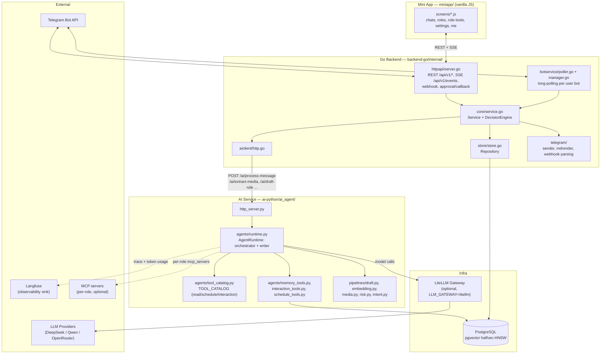
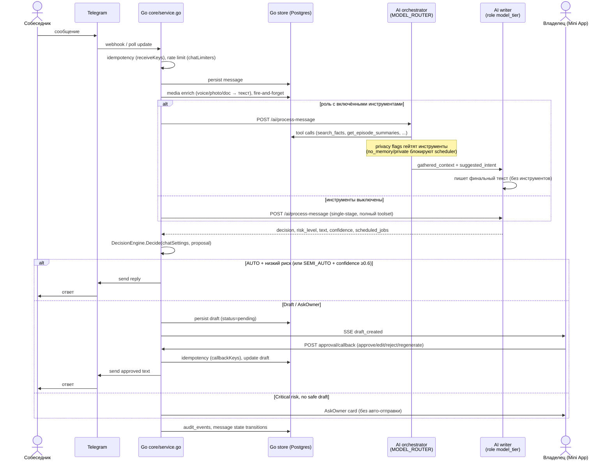
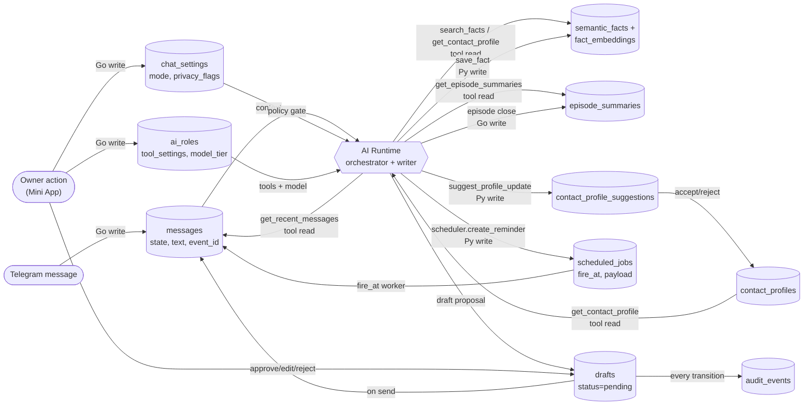

# System Diagrams

> Сгенерировано из реального кода (аудит 2026-06-26), не из плановых документов. При расхождении с
> кодом — верить коду, эти диаграммы поправить. Источники: `backend-go/internal/*`,
> `ai-python/ai_agent/*`, `infra/migrations/*`, `contracts/openapi.yaml`, `miniapp/*`.

Mermaid рендерится нативно на GitHub/GitLab — открыть файл напрямую в браузере репозитория.

---

## 1. Component diagram

Контейнеры и пакеты/модули внутри них. Стрелки — направление вызова (не направление данных).

**Что не показано намеренно:** `internal/config`, `internal/contracts`, `internal/observability`,
`internal/bot` — сквозные/инфраструктурные пакеты без отдельного потока вызовов, see
[`ai_backend_architecture_backlog.md`](../ai_backend_architecture_backlog.md) для деталей.

---

## 2. Sequence diagram — message lifecycle (bimodal orchestrator+writer)

Путь входящего сообщения от Telegram до ответа, включая двумодальное исполнение (commit `7364b14`) —
оркестратор выполняет инструменты и не пишет ответ, писатель пишет финал без инструментов.

---

## 3. Data flow diagram

Хранилища и кто их читает/пишет. `Go` = `backend-go/internal/store`, `Py` = `ai-python` (через прямой
asyncpg pool или Go repository, в зависимости от `AI_MEMORY_SOURCE`).

**Инварианты на каждой стрелке записи** (см. [`/docs/backlog.md`](../../backlog.md) и `CLAUDE.md`):
privacy-флаги (`no_memory`/`no_training`/`no_summary`/`private`) проверяются перед записью в
`semantic_facts`/`episode_summaries`/`scheduled_jobs`; все записи через `drafts`/`scheduled_jobs`/
`audit_events` идемпотентны (`receiveKeys`/`sendKeys`/`callbackKeys`/`idempotency_key`).

---

_Last verified against code: 2026-06-26. Regenerate by re-reading the files listed in the header, not by editing this file from memory._
